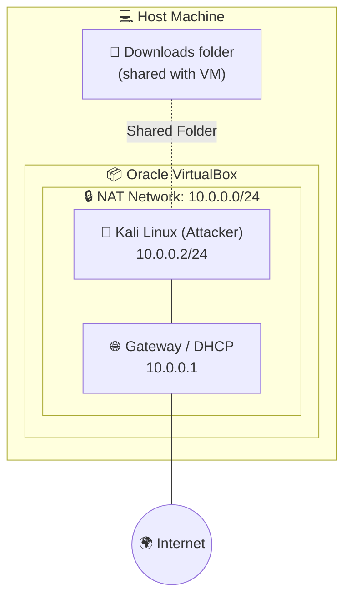

 Networkwalks--Week1---Lab-Setup-Virtualbox-and-Kali-Linux
Lab Setup Virtualbox and Kali Linux
<div align="center">

# 🐉 Cybersecurity Home Lab: VirtualBox + Kali Linux

### An isolated, NAT-networked ethical hacking lab, built from scratch


</div>

---

## 📌 Overview

This project documents my **Week 1 / Project Module 1** lab build: a safe, self-contained environment for cybersecurity and ethical hacking practice.

Everything runs inside **Oracle VirtualBox** on a single laptop. **Kali Linux** acts as the attacker machine, and a custom **NAT Network (`10.0.0.0/24`)** keeps all lab traffic isolated from my real network, while still giving the VMs full internet access.

> 🎯 **Goal:** a repeatable foundation I can snapshot, break, and restore while practising security tools and techniques.

---

## 🗺️ Lab Architecture



| Component | Details |
|---|---|
| **Hypervisor** | Oracle VirtualBox |
| **Attacker VM** | Kali Linux (pre-built VirtualBox image) |
| **Network type** | VirtualBox NAT Network (`NatNetwork`) |
| **Subnet** | `10.0.0.0/24` |
| **Kali IP** | `10.0.0.2/24` (static) |
| **Gateway** | `10.0.0.1` |
| **DNS** | `8.8.8.8` (fallback: `10.0.0.1`) |

---

## ✅ Requirements Checklist

- [x] VirtualBox installed as the base (latest recommended version)
- [x] Kali Linux set up as the attacking machine
- [x] Network configured in subnet `10.0.0.0/24`
- [x] VirtualBox **NAT Network** created with `10.0.0.0/24`
- [x] Clipboard and drag & drop enabled (Bidirectional)
- [x] Shared folder enabled, with the host **Downloads** folder shared into Kali
- [x] Kali static IP set to `10.0.0.2/24`
- [x] Kali has full internet access
- [x] Clean-state **snapshot** taken

---

## 🖥️ Host & Software Specs

| | |
|---|---|
| **Host OS** | ` Windows 10/11` |
| **CPU / RAM / Disk** | `Core i3 / 8 GB / 512 GB SSD` |
| **VirtualBox version** | ` 7.0.0.1` |
| **Kali Linux version** | `2026.2` |
| **Kali VM resources** | ` 4 GB RAM, 2 vCPUs` |

---

## 🚀 Setup Walkthrough

### Phase 1: Core Lab

**1. Install the tools**
Install [7-Zip](https://7-zip.org/download.html) (to extract the Kali archive) and [VirtualBox](https://www.virtualbox.org/wiki/Downloads).

**2. Create the NAT Network**
`File → Tools → Network → NAT Networks → Create`

| Setting | Value |
|---|---|
| Name | `NatNetwork` |
| IPv4 Prefix | `10.0.0.0/24` |
| Enable DHCP | ✅ |
| Enable IPv6 | ❌ |

**3. Import Kali Linux**
Download the pre-built **VirtualBox** image from [kali.org/get-kali](https://www.kali.org/get-kali/), extract it with 7-Zip, and add the `.vbox` file to VirtualBox.

**4. Configure the Kali VM in VirtualBox**

| Setting | Value |
|---|---|
| Network → Adapter 1 | Attached to **NAT Network**, name `NatNetwork` |
| Adapter type | Intel PRO/1000 MT Desktop |
| Promiscuous mode | Allow All |
| General → Advanced → Shared Clipboard | **Bidirectional** |
| General → Advanced → Drag'n'Drop | **Bidirectional** |
| Shared Folders | Host `Downloads` folder · Auto-mount ✅ · Full access |

**5. Set a static IP inside Kali**
Network icon → **Edit Connections** → *Wired connection 1* → **IPv4 Settings**

| Field | Value |
|---|---|
| Method | Manual |
| Address | `10.0.0.2` |
| Netmask | `24` |
| Gateway | `10.0.0.1` |
| DNS servers | `8.8.8.8` |

**6. Take a snapshot**
`Machine → Take Snapshot` so I can always roll back to a known-good state.

---

## 🔍 Verification

Run these inside Kali to confirm everything works:

```bash
# 1. Confirm the static IP
ip a                      # expect 10.0.0.2/24 on eth0

# 2. Confirm the default gateway
ip route                  # expect: default via 10.0.0.1

# 3. Test raw internet connectivity
ping -c 4 8.8.8.8

# 4. Test DNS resolution
ping -c 4 google.com
```

**Shared folder check:** the host Downloads folder should appear under `/media/sf_Downloads`.
If you get *permission denied*, add your user to the `vboxsf` group and reboot:

```bash
sudo usermod -aG vboxsf $USER
```

---

## 🛠️ Troubleshooting: Kali Has No Internet

This is a known issue on **VirtualBox 7.x + Kali 2026.1 or newer**. Duplicate address detection (DAD) can delay or block the static IP from coming up. This fix worked for me:

```bash
sudo nmcli connection modify "Wired connection 1" ipv4.dad-timeout 0
sudo nmcli connection down "Wired connection 1"
sudo nmcli connection up "Wired connection 1"
```

Then restart Kali. If it still fails, work through this checklist:

1. The NAT Network was created correctly (`10.0.0.0/24`, DHCP enabled)
2. The VM adapter is set to **NAT Network**, not plain NAT
3. No other VM on the same NAT Network uses `10.0.0.2`
4. Try DNS `10.0.0.1` instead of `8.8.8.8`
5. Restart the VMs, and then the host

---

## 📸 Screenshots

| NAT Network | Kali Network Adapter |
|:---:|:---:|
|  |  |

| Static IP Configuration | Shared Folder & Clipboard |
|:---:|:---:|
|  |  |

| `ip a` + Ping Test | Snapshot Taken |
|:---:|:---:|
|  |  |

---

## 🧭 Roadmap: Phase 2

Planned expansion of the lab, all on the same `NatNetwork`:

- [ ] Windows 10 VM (`10.0.0.10`)
- [ ] Windows 11 VM (`10.0.0.11`)
- [ ] Android x86 VM (`10.0.0.9`)
- [ ] Vulnerable CTF machines for hands-on practice
- [ ] Ping tests between all machines + a snapshot of each

---

## 💡 Key Takeaways

- How **NAT Networks** differ from plain NAT, Host-only, and Bridged adapters
- Assigning **static IPs** with NetworkManager and troubleshooting connectivity with `nmcli`
- Why **snapshots** matter in a lab where things are meant to break
- Using **shared folders** and clipboard integration to move files between host and VM
- Designing an **isolated** test network before running any security tools

---

## ⚠️ Disclaimer

This lab is for **educational and ethical purposes only**. Only test systems that you own or have explicit written permission to test. I am not responsible for any misuse of the tools or techniques practised in this environment.

---

## 🙏 Acknowledgements

Built as part of the Ethical Hacking / Cybersecurity course by [Networkwalks Academy](https://www.networkwalks.com). Thanks to the instructor and the community for the guidance and troubleshooting tips.

---

<div align="center">

### 👋 Let's Connect

**`<Your Name>`** · [LinkedIn](https://www.linkedin.com/in/your-profile) · [GitHub](https://github.com/your-username)

⭐ If you found this helpful, consider starring the repo!

</div>
